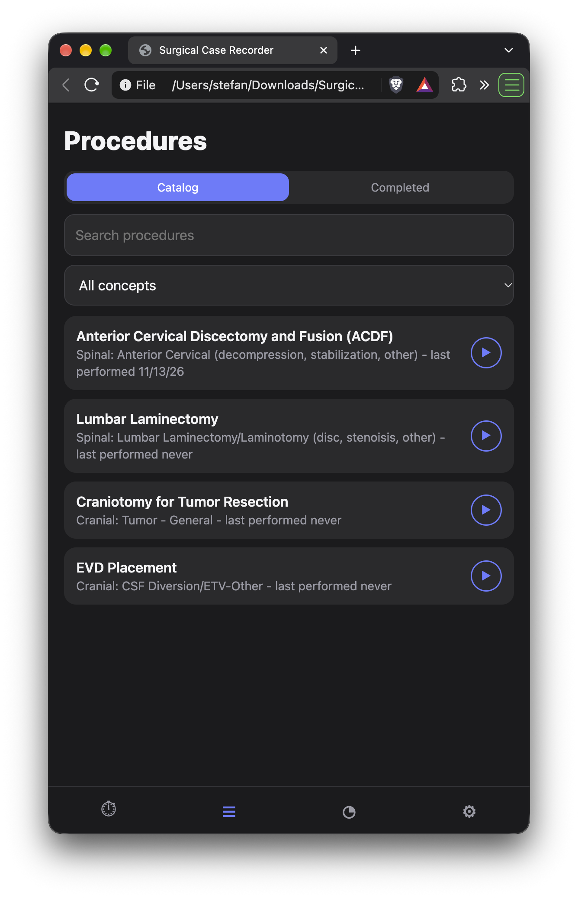
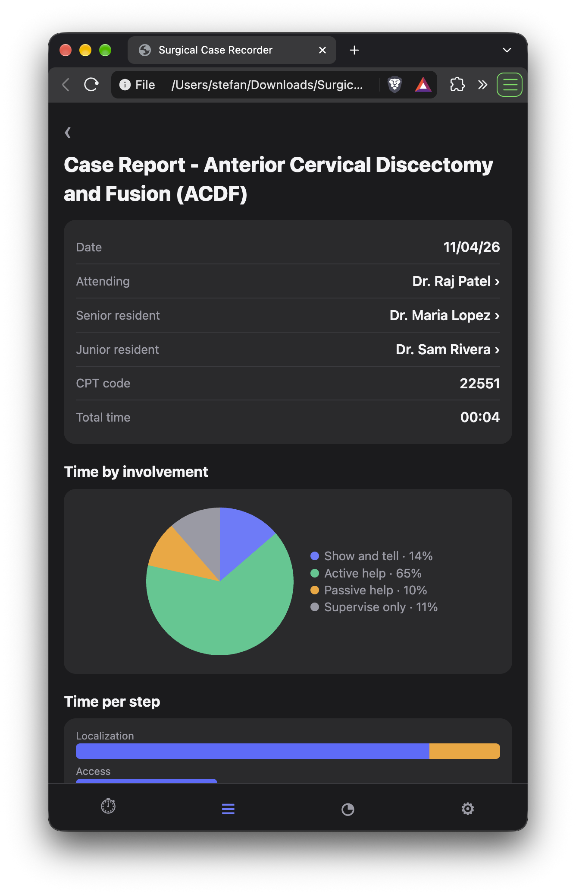
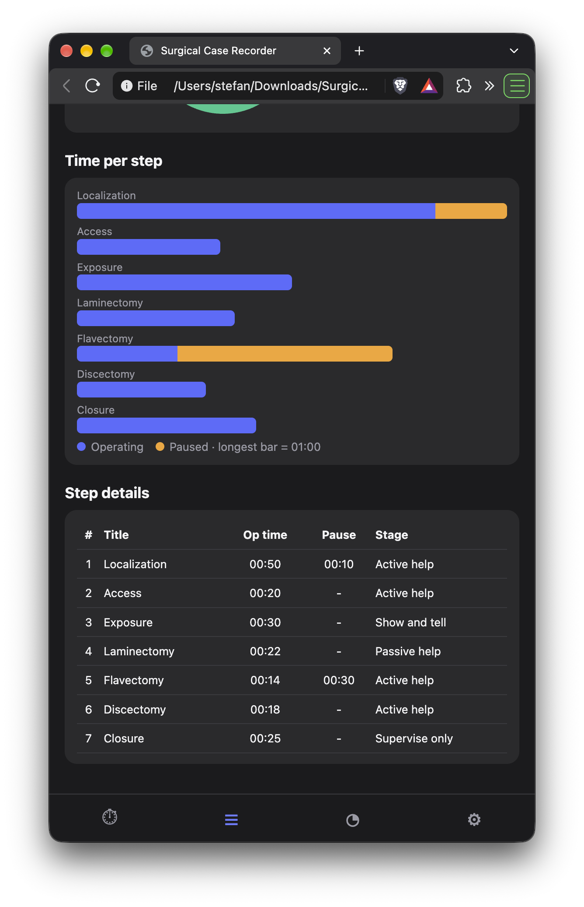

# Surgeval

A responsive webpage where a user is able to browse a catalog of different neurosurgical procedures that junior doctors can use to record their case logs. Each catalogued procedure will have a set of steps that will be timed as part of a stopwatch feature. During this time the user can also label each step based on their involvement in the case with grades:

1. Show and tell
2. Active help
3. Passive help
4. Supervise only

